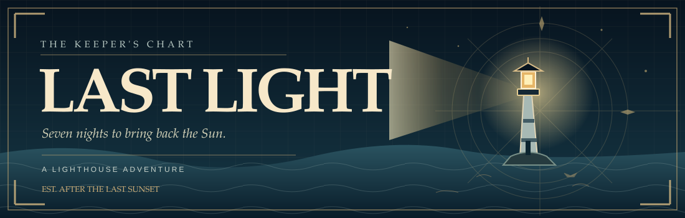
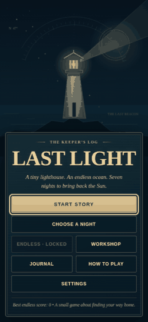
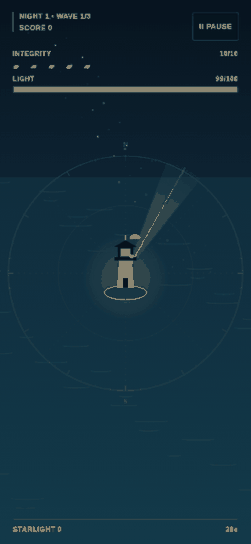

<p align="center">
  <a href="https://yushirm.github.io/last-light/" title="Play Last Light"></a>
</p>

<p align="center">
  <a href="https://yushirm.github.io/last-light/"></a>
</p>

<p align="center">
  <a href="https://yushirm.github.io/last-light/">Live game</a> &nbsp;·&nbsp;
  <a href="#the-watch">The watch</a> &nbsp;·&nbsp;
  <a href="#the-keepers-log">The keeper's log</a> &nbsp;·&nbsp;
  <a href="#run-it-locally">Run locally</a>
</p>

<p align="center">
  <a href="https://github.com/yushirm/last-light/actions/workflows/ci.yml"></a>
  
  
  
</p>

<p align="center"><em>A tiny lighthouse. An endless ocean. Seven nights to bring back the Sun.</em></p>

The Sun is gone. Something is moving beneath the water. You have a lighthouse, a dwindling beam and the occasional ship that still believes there is a way home.

**Last Light** is a free, single-player browser adventure. Hold back the darkness, guide lost ships to safety and piece together the story of the missing Sun. It plays on phones and desktops, and starts straight in your browser. No install, account or sign-up.

## Through the looking glass

<table>
  <tr>
    <td align="center" width="50%"><strong>The lighthouse</strong></td>
    <td align="center" width="50%"><strong>The night watch</strong></td>
  </tr>
  <tr>
    <td align="center"></td>
    <td align="center"></td>
  </tr>
  <tr>
    <td align="center"><small>Welcome to the keeper's chart.</small></td>
    <td align="center"><small>Every second of light counts.</small></td>
  </tr>
</table>

*Both clips were recorded from the game running in Chromium. They're short, silent and loop automatically. The game itself also has optional audio.*

## By the numbers

| The campaign | The choices | Under the hood |
| :--- | :--- | :--- |
| **7** story nights | **12** in-night upgrades | **0** runtime dependencies |
| **21** story waves | **3** permanent Workshop upgrades | **8** achievements |
| **7** final encounters | **1** unlockable Endless mode | **100%** browser-based |

These are **game-content counts**, taken from the source, not invented player, download or engagement figures. The campaign has three waves per night, and each night ends with its own encounter. The last night has a different kind of finale.

## The watch

The rules are simple. The sea isn't.

- **Aim and shine.** Sweep the beam across the water to drive back approaching shadows. Keep an eye on your energy. A dead lamp helps nobody.
- **Bring them home.** Hold the beam on a golden ship long enough to guide it to safety. Rescues earn starlight and help keep the light alive.
- **Make a choice.** Survive a wave, choose an upgrade, then try to survive the next one. Your run changes as the night goes on.
- **Face the dark.** Each of the seven nights has its own final encounter. Finish the story to unlock Endless mode.
- **Repair what you can.** Spend banked starlight in the Workshop on lasting improvements to the lamp, battery and lighthouse walls.

### Controls

| | Aim | Shine | Pause |
| :--- | :--- | :--- | :--- |
| **Touch** | Drag on the water | Keep your finger down | Tap **Pause** |
| **Mouse** | Move or drag | Hold left click | Click **Pause** |
| **Keyboard** | `A` / `D` or `←` / `→` | Hold `Space` | `P` or `Esc` |

Release the beam to recharge. Menus support standard keyboard navigation and visible focus states.

## The keeper's log

Last Light's interface takes its cues from old nautical charts, lighthouse instruments and handwritten logbooks. The game combines illustrated Canvas 2D scenes with accessible HTML menus. You'll find the design notes in [the visual-language guide](docs/visual-language.md).

Your campaign progress, settings, achievements and personal bests live in your browser's `localStorage`, under `last-light-save-v1`. Completed nights stay completed. Closing the tab mid-run means starting that attempt again; it won't erase nights you've already finished. Clearing the site's storage or using another browser starts a separate save.

The game doesn't ask for personal information or send your progress to a server. There are no analytics, advertising SDKs or external gameplay assets.

## Run it locally

All you need is a modern browser and a local web server. From the repository root:

```bash
python3 -m http.server 8000
```

Then visit **http://localhost:8000/**. The game uses ES modules, so opening `index.html` directly with `file://` is not supported by every browser. All asset paths are relative, which also lets the game run from the GitHub Pages `/last-light/` path.

### Tests and repository checks

Node.js 22+ is recommended. Nothing needs to be installed with npm.

```bash
npm run check
```

This runs the committed-file safety scan, static project validation and unit tests. The same checks run automatically in [GitHub Actions](https://github.com/yushirm/last-light/actions/workflows/ci.yml) for updates to `main` and pull requests targeting it.

| Part | Source |
| :--- | :--- |
| Story, enemies, waves, upgrades | [`src/config.js`](src/config.js), [`src/story.js`](src/story.js) |
| Simulation and encounters | [`src/simulation.js`](src/simulation.js), [`src/encounters.js`](src/encounters.js) |
| Canvas art and interface | [`src/renderer.js`](src/renderer.js), [`src/screens.js`](src/screens.js), [`styles.css`](styles.css) |
| Controls, audio and save data | [`src/input.js`](src/input.js), [`src/audio.js`](src/audio.js), [`src/storage.js`](src/storage.js) |
| Automated tests | [`tests/`](tests/) |

## A note about how it was made

The first version of Last Light was **generated using OpenAI ChatGPT from a detailed game brief**. That includes the initial game code, tests and documentation. It wasn't handwritten by the repository owner. Subsequent changes may also be AI-assisted. The project is published so people can play it and inspect how it works, not as a claim of personally handwritten code.

The repository has a dedicated [security policy](SECURITY.md) and a committed-file scanner for common credentials and personal information. Those checks are precautions, not guarantees. If you spot a security problem, please use the instructions in [`SECURITY.md`](SECURITY.md) rather than posting sensitive details in a public issue.

## Licence

The game is public to view and play, but the source **is not open-source licensed**. See [`LICENSE`](LICENSE) for the copyright and redistribution terms.

<p align="center"><sub>Keep the light on. Somewhere out there, another ship is looking for home.</sub></p>